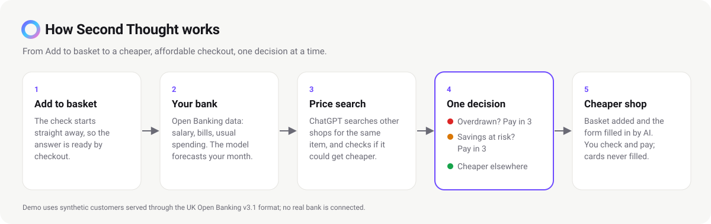
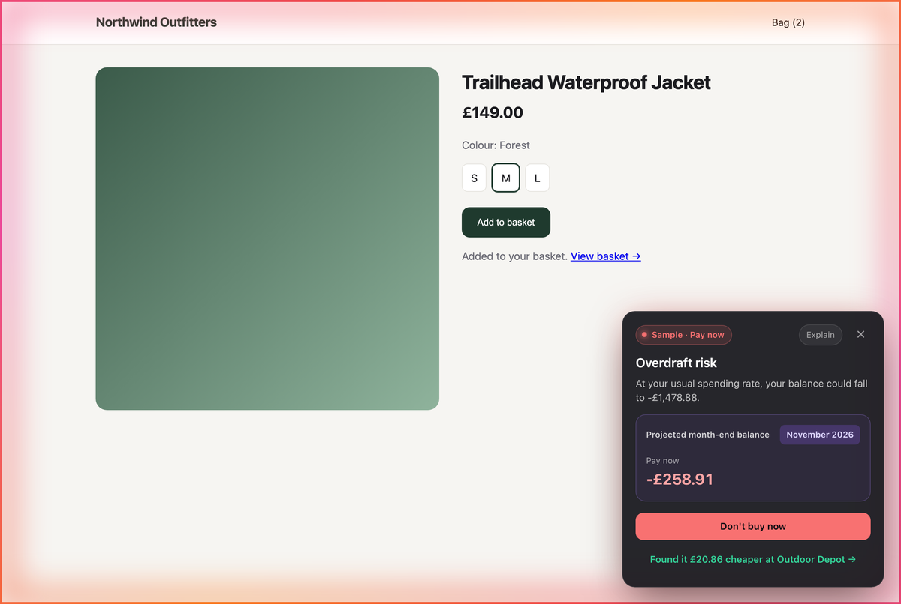
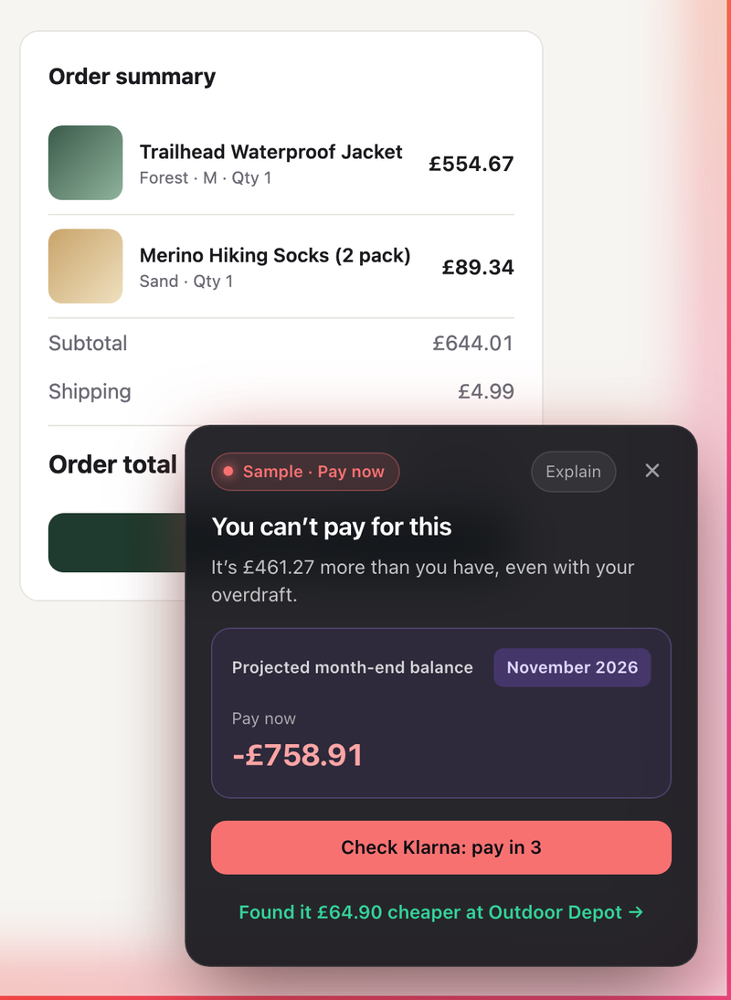
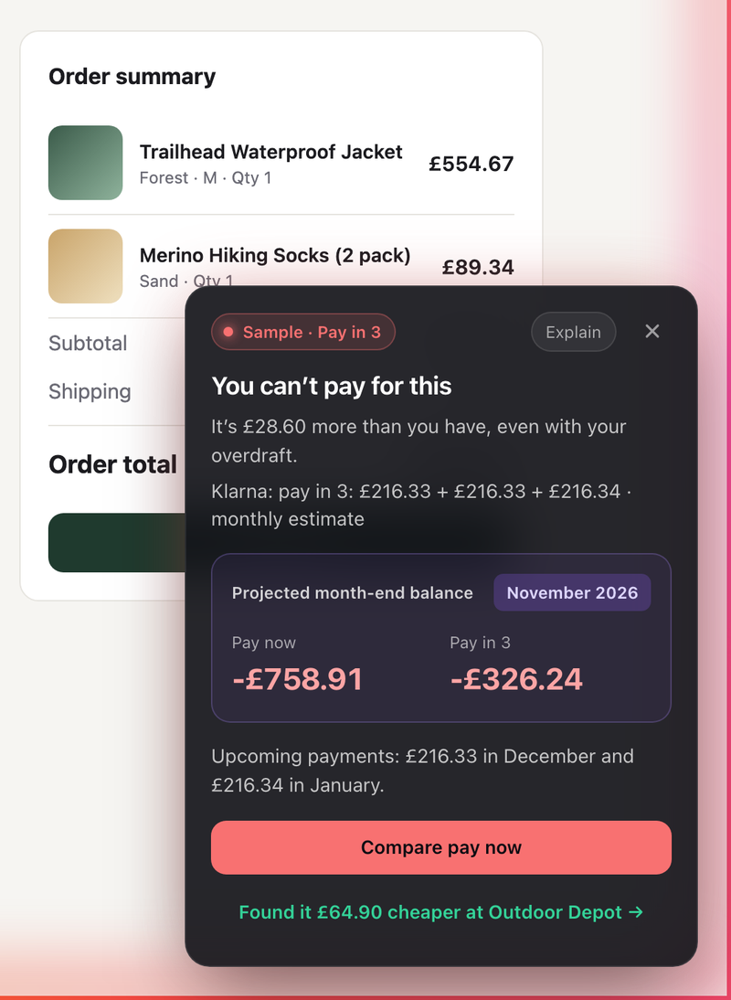
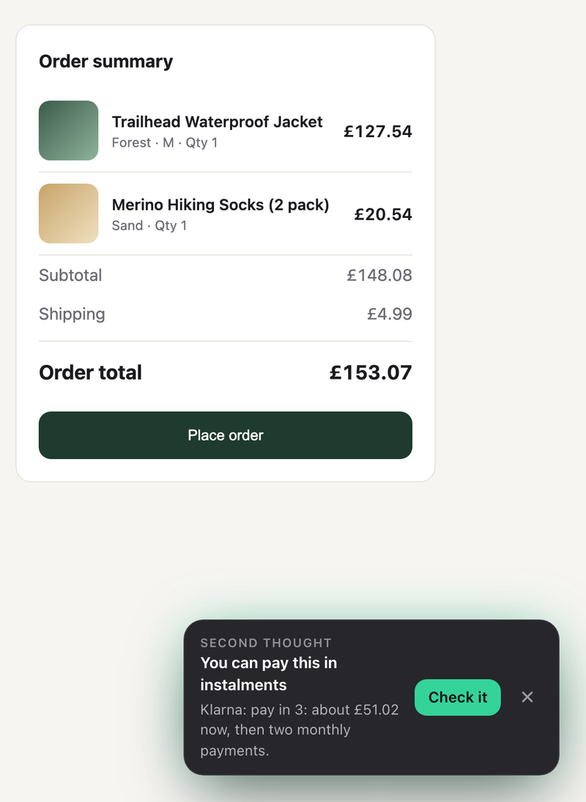
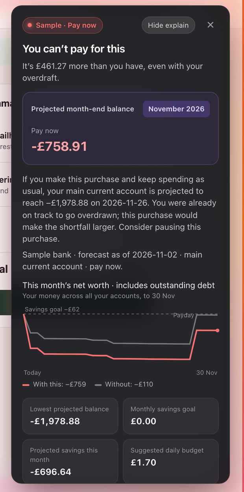

# Second Thought

**A Chrome extension that steps in at checkout to tell you, from your bank data in the UK Open Banking format, whether
you can really afford a purchase, finds the same item cheaper elsewhere, and offers pay in 3 when buying it now would
leave you overdrawn or behind on your savings.**

Built at HackTheBurgh 2026 for Bank of Scotland's "Smart Cost of Living" challenge.

## What it does at checkout

| Step | What you see |
| --- | --- |
| Add to basket | A quick check starts straight away, so the answer is ready by checkout |
| Can you afford it? | The affordability model forecasts your month from your bank data (salary, bills, usual spending) and says plainly if it would leave you overdrawn or behind on your savings goal, with a chart of the rest of the month |
| Cheaper elsewhere | ChatGPT searches other shops for the same item; one click opens that shop's checkout with your basket and details filled in by the AI |
| Could it get cheaper? | Price history and upcoming sales; "Notify me if it drops" watches the price for you |
| Pay in 3 | Offered whenever buying now would overdraw you or hurt your savings, with the instalments checked against your month |

One decision at a time, never a menu. Card details are never stored or filled in.

## Screenshots

From the demo shop, with the affordability model running on sample customer 029.

<table>
<tr>
<td width="33%" valign="top"> <b>At checkout.</b> More than the customer has, even with their overdraft: pay in 3 first, the cheaper shop underneath.</td>
<td width="33%" valign="top"> <b>Pay in 3.</b> The three instalments checked against the month: −£326 at the month's end instead of −£759.</td>
<td width="33%" valign="top"> <b>At the cheaper shop.</b> Basket and details filled in; just a note that instalments are available.</td>
</tr>
</table>

**Explain** shows how the answer was reached: the customer's money across all their accounts for the rest of the
month, with and without the purchase, against their savings goal, plus the lowest projected balance and a suggested
daily budget. Every figure comes from the affordability model reading the customer's Open Banking data.

 

## Get started

1. `git clone https://github.com/HFSquires/HackTheBurgh.git` (private: ask Harrison for access).
2. In Chrome: `chrome://extensions` → **Developer mode** → **Load unpacked** → choose the `extension` folder.
3. Right-click the toolbar icon → **Options**: add your OpenAI or ELM API key and your delivery details. Add your bank
   statement, or for a quick start choose **Sample customer 029**.
4. Start the bank forecast from this folder, in two terminals (Python 3.11 or later, nothing to install):
   `python3 -X utf8 mock_bank.py --serve --source v2` and `python3 -X utf8 model.py --serve`.
5. Go to any shop's checkout.

The full step-by-step guide, with troubleshooting, is in [`extension/README.md`](extension/README.md#get-started).

## What's in this repository

| Folder or file | What it is |
| --- | --- |
| `extension/` | The Chrome extension (Manifest V3): checkout detection, the panel, price search, switching shop, form filling |
| `web/` | Account site (Auth0 sign-in, Firestore, Vercel) for saving details the extension syncs |
| `model.py` | The affordability model: forecasts the month and decides whether a purchase fits (`POST /decide`) |
| `mock_bank.py` | A mock bank serving synthetic customers through the UK Open Banking Read/Write API v3.1 |
| `statements.py`, `ob_generator.py`, `mock_statements.py`, `market_data.py` | Statement parsing, synthetic data generation (100 UK customers) and ONS/FCA market data |
| `Analysis/`, `data/` | Generated data and the public source data it is built from |
| `model outline/` | The design of the affordability model (Andrew's outline and its implementation notes) |
| `archive/` | The earlier engine and figures, retired when `model.py` replaced them; kept for reference |
| `docs/images/` | The diagram and screenshots on this page |

The customers and their bank data are synthetic; no real bank is connected. Team records: `BRIEF.md` (the challenge),
`DECISIONS.md`, `TASKS.md` and `USER_GUIDE.md`.
